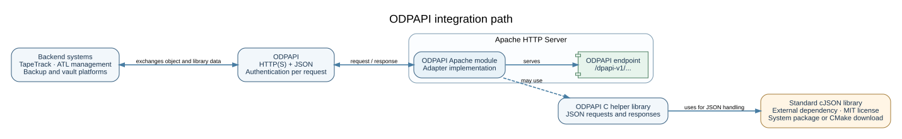

# Open Data Protection API (ODPAPI)

ODPAPI is an open protocol for exchanging information between data owners and
data custodians. Its original use case is interoperability among tape library
management systems, backup software, off-site storage providers, and systems
that coordinate those services. The goal is to make integrations more portable
and allow compatible libraries and software to work together without a
provider-specific interface for every pairing.

This GitHub project contains the protocol materials and a C helper library.
It does not contain the TapeTrack adapter. That adapter is a separate,
closed-source implementation built on ODPAPI.



The editable Graphviz source is `graphics/odpapi-architecture.dot`.

## Design goals

The original ODPAPI specification describes these goals:

- Share object and media information between libraries.
- Support movement of objects between libraries and allow libraries to be
  interchanged.
- Provide a common interface for software controlling physical libraries,
  backup systems, and off-site custodians.

The protocol uses stateless HTTP or HTTPS requests, JSON request and response
bodies, and HTTP authentication. Authentication is per request; credentials
and session tokens are not part of the protocol examples. Implementations
should use HTTPS in real deployments and must manage credentials outside source
code and example files.

## Protocol operations

The historical specification describes operations for:

- **Inventory** — report objects held by a library and their status.
- **Move** — request movement of objects from a source library to a target.
- **Scan** — report that objects were scanned at a library, with a scan reason.
- **Add** — add object records to a library.
- **Update** — update object information.
- **List** — enumerate accessible libraries and their properties.
- **Query** — report available functions or service capabilities.

Requests and responses carry JSON data. Common result codes report the overall
request outcome; per-object statuses report results for individual objects.
Implementations should preserve request sequence numbers so clients can match
each result with its input item.

Library identifiers are 128-bit GUIDs. The original design allows an
implementation to encode provider-specific identifiers in the GUID, and only
requires uniqueness within a server scope. Integrators should agree on a stable
GUID mapping and scope with each provider; an encoded GUID is not automatically
globally meaningful.

## Project layout

- `include/odpapi.h` — public C helper API and protocol status enumerations.
- `src/odpapi.c` — JSON request lookup and response construction helpers.
- `test/` — sample JSON request and response documents. They are not a live
  integration test suite.
- `wiki/` — draft pages for the GitHub project wiki, based on the historical
  protocol document.
- `ADAPTER-CONTRACT.md` — technical interoperability expectations for
  independent implementations (not a legal agreement).
- `AGENTS.md` — guidance for AI coding agents working with ODPAPI or using it
  as a reference for a separate adapter.
- `CONTRIBUTING.md` — project contribution terms and review expectations.
- `ECOSYSTEM.md` — how adapter maintainers can request a public listing.

The source tree also contains the original 2013–2014 specification and a
historical co-development agreement. Those source documents are excluded from
the GitHub repository pending rights and attribution review. The specification
is useful background, but contains incomplete sections and examples that
conflict with one another or with the C helper enums. The wiki drafts summarize
its purpose and use without treating it as a current normative specification.

## Build the C helper library

Requirements: CMake 3.21 or newer and a C99-compatible compiler. Doxygen is
optional. JSON handling uses the standard upstream
[cJSON library](https://github.com/DaveGamble/cJSON), rather than a project-specific
copy. CMake prefers an installed cJSON development package (for example,
`libcjson-dev` on Debian/Ubuntu or `cjson-devel` on Fedora). If none is found,
it downloads and builds cJSON 1.7.19 with a verified SHA-256 checksum. The first
configuration then requires network access.

```sh
cmake -S . -B build -DCMAKE_BUILD_TYPE=Release -DCMAKE_INSTALL_PREFIX="$PWD/install"
cmake --build build --config Release
cmake --install build --config Release
```

To require an installed cJSON library without downloading anything, configure
with `-DODPAPI_FETCH_CJSON=OFF`. To download the pinned release even when a system
library is installed, use `-DODPAPI_USE_SYSTEM_CJSON=OFF`. Downloaded sources and
build output stay in the build directory. When cJSON is downloaded, CMake also
installs its library, header, and MIT license with ODPAPI.

When Doxygen is available at configure time, CMake adds the `odpapi-docs`
target. Generate the HTML API reference with:

```sh
cmake --build build --target odpapi-docs
```

The output is placed under `build/docs/html`. GitHub Actions configures, builds,
and installs the library on Linux, macOS, and Windows for pushes and pull
requests.

The library is currently built as a static library. `ODPAPI::odpapi` propagates
the cJSON include directory and link dependency to applications automatically,
including when using the installed CMake package. Consumers building without
CMake must also provide the cJSON include and link flags, commonly obtained
with `pkg-config --cflags --libs libcjson`. cJSON's MIT terms apply separately;
see `NOTICE` and the upstream cJSON license.

## Licensing and contributions

ODPAPI materials owned by GazillaByte Pty Ltd are licensed under the Apache
License 2.0. The license grants broad reuse rights, including use in both
open-source and proprietary software, subject to its terms. Third-party and
historical material may have separate copyright or license terms; those notices
remain in force. See `LICENSE`, `NOTICE`, and individual file notices.

Contributions submitted for inclusion are understood to be offered under
Apache-2.0 unless a contribution is explicitly marked otherwise. Before
contributing, ensure you have the right to submit the material under those
terms.
